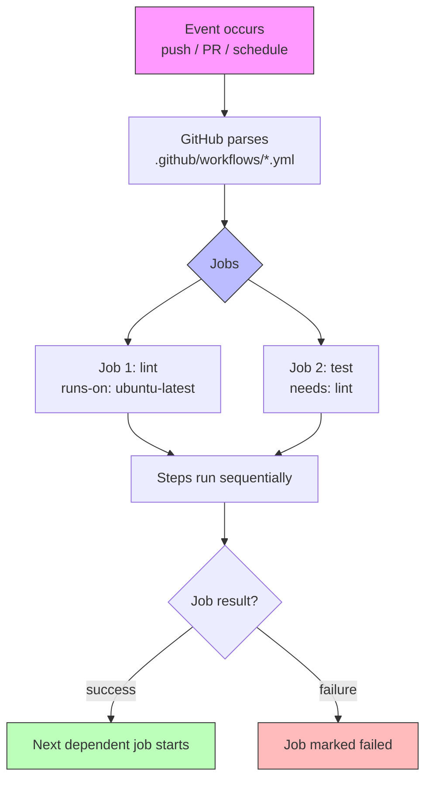

# Foundations

Everything in GitHub Actions starts with a **workflow** — an automated process you define in a YAML file that lives in your repository at `.github/workflows/`.

> **Certification tip:** The exam tests your ability to read and write workflow YAML quickly. Know the top-level keys by heart.

---

## 1. Workflow Anatomy

A workflow file uses these top-level keys:

| Key | Required | Purpose |
|-----|----------|---------|
| `name` | No | Human-readable name shown in the Actions tab |
| `on` | Yes | Event(s) that trigger the workflow |
| `jobs` | Yes | One or more jobs that run in parallel by default |
| `env` | No | Variables available to all jobs/steps |
| `defaults` | No | Default settings for all steps |
| `permissions` | No | Token permissions for the whole workflow |

### Minimal valid workflow

```yaml
name: CI

on: push

jobs:
  build:
    runs-on: ubuntu-latest
    steps:
      - name: Say hello
        run: echo "Hello, GitHub Actions!"
```

---

## 2. Events (`on`)

Events tell GitHub when to run the workflow.

### Common triggers

```yaml
on:
  push:
    branches: ["main", "feature/*"]
    tags: ["v*"]

  pull_request:
    branches: ["main"]

  workflow_dispatch:
    inputs:
      environment:
        description: "Deploy target"
        required: true
        default: "staging"
        type: choice
        options:
          - staging
          - production

  schedule:
    - cron: "0 2 * * *"   # Every day at 02:00 UTC

  repository_dispatch:
    types: [build-requested]

  workflow_run:
    workflows: ["CI"]
    types: [completed]
```

> **Certification tip:** `workflow_dispatch` lets you pass inputs manually — great for on-demand deployments. `schedule` uses POSIX cron and is always UTC.

---

## 3. Jobs

Jobs run in **parallel** by default. Each job runs on a fresh runner instance.

### Job structure

```yaml
jobs:
  lint:
    runs-on: ubuntu-latest
    steps:
      - uses: actions/checkout@v4
      - run: npm run lint

  test:
    needs: lint
    runs-on: ubuntu-latest
    steps:
      - uses: actions/checkout@v4
      - run: npm test
```

| Key | Purpose |
|-----|---------|
| `runs-on` | The runner type |
| `needs` | Dependency — wait for listed jobs first |
| `if` | Conditional — skip unless expression is true |
| `outputs` | Pass data to downstream jobs |
| `permissions` | Scope the `GITHUB_TOKEN` for this job |

---

## 4. Steps

Steps run **sequentially** inside a job. Each step is either `uses:` (calls an action) or `run:` (executes a shell command).

### Step example

```yaml
jobs:
  build:
    runs-on: ubuntu-latest
    steps:
      - name: Checkout code
        uses: actions/checkout@v4

      - name: Set up Node.js
        uses: actions/setup-node@v4
        with:
          node-version: '20'

      - name: Install dependencies
        run: npm ci

      - name: Run tests
        run: npm test
        env:
          NODE_ENV: test
```

> **Certification tip:** Always pin actions to a specific version tag (e.g. `@v4`) — never `@main`.

---

## 5. Runners

### GitHub-hosted runners

| Label | OS | Use case |
|-------|-----|----------|
| `ubuntu-latest` | Ubuntu | Most common, cheapest |
| `windows-latest` | Windows | .NET, Windows-specific builds |
| `macos-latest` | macOS | iOS/macOS builds, Xcode |

### Self-hosted runners

```yaml
runs-on: self-hosted
# or with labels
runs-on: [self-hosted, linux, x64]
```

---

## 6. Contexts & Expressions

```yaml
jobs:
  example:
    runs-on: ubuntu-latest
    steps:
      - run: echo "Running on ${{ github.ref }}"
      - run: echo "Actor: ${{ github.actor }}"
```

| Context | Example value |
|---------|---------------|
| `github.event_name` | `push` |
| `github.ref` | `refs/heads/main` |
| `github.sha` | `a1b2c3d4...` |
| `github.actor` | `octocat` |
| `github.repository` | `owner/repo` |

---

## 7. Visual: How a Workflow Runs



---

## 8. Real-World Use Case: Node.js CI

```yaml
name: Node.js CI

on:
  push:
    branches: [main]
  pull_request:
    branches: [main]

jobs:
  test:
    runs-on: ubuntu-latest
    strategy:
      matrix:
        node-version: [18.x, 20.x]
    steps:
      - uses: actions/checkout@v4
      - name: Use Node.js ${{ matrix.node-version }}
        uses: actions/setup-node@v4
        with:
          node-version: ${{ matrix.node-version }}
          cache: 'npm'
      - run: npm ci
      - run: npm test
```

---

## 9. Hands-On Exercise: Your First Workflow

Create `.github/workflows/hello.yml` in your test repository:

```yaml
name: Hello World

on:
  workflow_dispatch:
    inputs:
      name:
        description: "Your name"
        required: true
        default: "Learner"

jobs:
  greet:
    runs-on: ubuntu-latest
    steps:
      - name: Greet the user
        run: echo "Hello, ${{ github.event.inputs.name }}!"
```

**Verification checklist:**
- [ ] The workflow appears in the Actions tab
- [ ] You can trigger it manually with a custom name
- [ ] The output shows your name

---

## 10. Quick Reference Cheat Sheet

```yaml
name: <workflow name>
on: <event>
jobs:
  <job_id>:
    runs-on: ubuntu-latest
    steps:
      - uses: <action>@v4
      - run: <command>
```

**Next module:** [Triggers & Scheduling →](/study/triggers)
