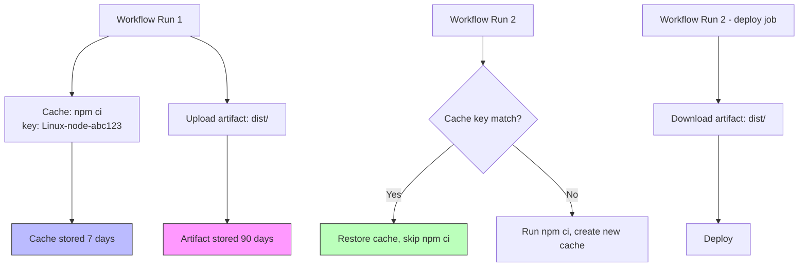

# Caching & Artifacts

Caching speeds up workflows by reusing dependencies between runs. Artifacts pass files between jobs and preserve build outputs after a run finishes. The exam tests cache key strategies, restore keys, artifact upload/download, and retention.

> **Certification tip:** Cache and artifacts are different. Cache is for dependencies (node_modules, Maven, pip). Artifacts are for build outputs (binaries, test reports, deployment packages).

---

## 1. Caching with `actions/cache`

The `actions/cache` action saves and restores directories based on a key. If the key matches exactly, the cache is restored. If not, a new cache is created.

### Basic cache example

```yaml
jobs:
  build:
    runs-on: ubuntu-latest
    steps:
      - uses: actions/checkout@v4
      - uses: actions/setup-node@v4
        with:
          node-version: '20'
      - name: Cache node_modules
        uses: actions/cache@v4
        with:
          path: ~/.npm
          key: ${{ runner.os }}-node-${{ hashFiles('**/package-lock.json') }}
      - run: npm ci
      - run: npm test
```

### `actions/cache@v4` parameters

| Parameter | Purpose |
|-----------|---------|
| `path` | Directory or file to cache |
| `key` | Exact cache key (must match to restore) |
| `restore-keys` | Fallback keys if exact match fails |

---

## 2. Cache Keys and Restore Keys

### Exact match (`key`)

A cache key is typically built from:
- Runner OS (`${{ runner.os }}`)
- Dependency manager
- Hash of lock file (`hashFiles('**/package-lock.json')`)

```yaml
key: ${{ runner.os }}-npm-${{ hashFiles('**/package-lock.json') }}
```

If `package-lock.json` changes, the hash changes, GitHub creates a **new** cache entry instead of overwriting the old one.

### Fallback keys (`restore-keys`)

When the exact key doesn't match, GitHub tries `restore-keys` in order. The first partial match wins.

```yaml
- uses: actions/cache@v4
  with:
    path: ~/.npm
    key: ${{ runner.os }}-node-${{ hashFiles('**/package-lock.json') }}
    restore-keys: |
      ${{ runner.os }}-node-
      ${{ runner.os }}-
```

**How restore keys work:**

| Key tried | Match type | Result |
|-----------|-----------|--------|
| `Linux-node-v1.` | Exact | Restore exact cache |
| `Linux-node-` | Prefix | Restore newest cache starting with this |
| `Linux-` | Prefix | Restore newest cache starting with this |

> **Certification tip:** Order `restore-keys` from most specific to least specific. GitHub restores the **most recent** cache that matches the first successful prefix.

### Multiple paths

```yaml
- uses: actions/cache@v4
  with:
    path: |
      ~/.npm
      ~/.cache/Cypress
    key: ${{ runner.os }}-deps-${{ hashFiles('**/package-lock.json') }}
```

### Cache limits

| Limit | Value |
|-------|-------|
| Cache size per repo | 10 GB |
| Cache retention | 7 days (evicted if not accessed) |
| Concurrent cache operations | Limited per repository |

> **Certification tip:** Caches are immutable — you can't update an existing cache. If the key changes, a new cache entry is created. Old caches are evicted after 7 days of inactivity.

---

## 3. Cache Examples by Language

### Node.js / npm

```yaml
- uses: actions/cache@v4
  with:
    path: ~/.npm
    key: ${{ runner.os }}-node-${{ hashFiles('**/package-lock.json') }}
    restore-keys: |
      ${{ runner.os }}-node-
```

### Node.js / Yarn

```yaml
- uses: actions/cache@v4
  with:
    path: ~/.yarn-cache
    key: ${{ runner.os }}-yarn-${{ hashFiles('**/yarn.lock') }}
    restore-keys: |
      ${{ runner.os }}-yarn-
```

### Python / pip

```yaml
- uses: actions/cache@v4
  with:
    path: ~/.cache/pip
    key: ${{ runner.os }}-pip-${{ hashFiles('**/requirements.txt') }}
    restore-keys: |
      ${{ runner.os }}-pip-
```

### Go

```yaml
- uses: actions/cache@v4
  with:
    path: ~/go/pkg/mod
    key: ${{ runner.os }}-go-${{ hashFiles('**/go.sum') }}
    restore-keys: |
      ${{ runner.os }}-go-
```

### Java / Maven

```yaml
- uses: actions/cache@v4
  with:
    path: ~/.m2/repository
    key: ${{ runner.os }}-maven-${{ hashFiles('**/pom.xml') }}
    restore-keys: |
      ${{ runner.os }}-maven-
```

### Java / Gradle

```yaml
- uses: actions/cache@v4
  with:
    path: ~/.gradle/caches
    key: ${{ runner.os }}-gradle-${{ hashFiles('**/*.gradle*', '**/gradle-wrapper.properties') }}
    restore-keys: |
      ${{ runner.os }}-gradle-
```

### .NET / NuGet

```yaml
- uses: actions/cache@v4
  with:
    path: ~/.nuget/packages
    key: ${{ runner.os }}-nuget-${{ hashFiles('**/*.csproj') }}
    restore-keys: |
      ${{ runner.os }}-nuget-
```

### Ruby / Bundler

```yaml
- uses: actions/cache@v4
  with:
    path: vendor/bundle
    key: ${{ runner.os }}-bundler-${{ hashFiles('**/Gemfile.lock') }}
    restore-keys: |
      ${{ runner.os }}-bundler-
```

---

## 4. Artifacts: `upload-artifact` and `download-artifact`

Artifacts are files produced by a job that you want to keep after the workflow ends. They're stored by GitHub for up to 90 days.

### Upload an artifact

```yaml
jobs:
  build:
    runs-on: ubuntu-latest
    steps:
      - uses: actions/checkout@v4
      - run: npm run build
      - name: Upload build output
        uses: actions/upload-artifact@v4
        with:
          name: dist
          path: dist/
          retention-days: 7
```

### Download an artifact

```yaml
jobs:
  deploy:
    needs: build
    runs-on: ubuntu-latest
    steps:
      - name: Download build output
        uses: actions/download-artifact@v4
        with:
          name: dist
          path: dist/
      - run: echo "Deploying from dist/..."
```

### `upload-artifact@v4` parameters

| Parameter | Purpose | Default |
|-----------|---------|---------|
| `name` | Artifact name | `artifact` |
| `path` | Files/directories to upload | Required |
| `retention-days` | How long to keep | 90 |

### `download-artifact@v4` parameters

| Parameter | Purpose | Default |
|-----------|---------|---------|
| `name` | Artifact name to download | Required |
| `path` | Where to download to | `.` |
| `merge-multiple` | Allow multiple artifacts with same name | `false` |

---

## 5. Cache vs Artifacts — Decision Guide

| | Cache (`actions/cache`) | Artifacts (`upload-artifact`) |
|---|---|---|
| Purpose | Speed up builds (dependencies) | Save outputs (binaries, reports) |
| Scope | Within repo, across runs | Between jobs, after workflow ends |
| Key-based | Yes (`key`, `restore-keys`) | No (by name) |
| Retention | 7 days (evicted) | Configurable (default 90 days) |
| Overwrite | No (new key = new entry) | Yes (same name overwrites) |
| Best for | `node_modules`, `.m2`, `~/.gradle` | Built binaries, test reports, deploy packages |

---

## 6. Visual: Cache and Artifact Flow



---

## 7. Real-World Use Case: Build → Test → Deploy with Artifacts

```yaml
name: CI/CD with Artifacts

on:
  push:
    branches: [main]

jobs:
  build:
    runs-on: ubuntu-latest
    steps:
      - uses: actions/checkout@v4
      - uses: actions/setup-node@v4
        with:
          node-version: '20'
          cache: 'npm'  # Built-in npm caching
      - run: npm ci
      - run: npm run build
      - name: Upload build artifact
        uses: actions/upload-artifact@v4
        with:
          name: build-dist
          path: dist/
          retention-days: 7

  test:
    needs: build
    runs-on: ubuntu-latest
    steps:
      - uses: actions/checkout@v4
      - name: Download build artifact
        uses: actions/download-artifact@v4
        with:
          name: build-dist
          path: dist/
      - run: npm test

  deploy:
    needs: test
    if: github.ref == 'refs/heads/main'
    runs-on: ubuntu-latest
    steps:
      - name: Download build artifact
        uses: actions/download-artifact@v4
        with:
          name: build-dist
      - run: echo "Deploying dist/ to production..."
```

> **Certification tip:** The `cache: 'npm'` shortcut in `actions/setup-node@v4` automatically handles npm caching — you don't need `actions/cache` separately for npm. Know both approaches for the exam.

---

## 8. Hands-On Exercise: Cache and Artifact

Create `.github/workflows/cache-artifacts.yml`:

```yaml
name: Cache and Artifact Exercise

on:
  workflow_dispatch:

jobs:
  build:
    runs-on: ubuntu-latest
    steps:
      - uses: actions/checkout@v4
      - uses: actions/setup-node@v4
        with:
          node-version: '20'
      - name: Cache npm dependencies
        uses: actions/cache@v4
        with:
          path: ~/.npm
          key: ${{ runner.os }}-npm-${{ hashFiles('**/package-lock.json') }}
          restore-keys: |
            ${{ runner.os }}-npm-
      - run: npm ci
      - run: mkdir -p dist && echo "build output" > dist/app.txt
      - name: Upload build artifact
        uses: actions/upload-artifact@v4
        with:
          name: my-app
          path: dist/

  deploy:
    needs: build
    runs-on: ubuntu-latest
    steps:
      - name: Download build artifact
        uses: actions/download-artifact@v4
        with:
          name: my-app
      - run: |
          ls -la
          cat app.txt
```

### Verification checklist
- [ ] First run: cache is created (no restore)
- [ ] Second run with unchanged `package-lock.json`: cache is restored
- [ ] `dist/app.txt` is uploaded and downloaded between jobs
- [ ] Check the Actions tab — see "Cache restored" or "Cache not found" messages

> **Exam connection:** This covers `actions/cache` key/restore-keys, `actions/upload-artifact`, `actions/download-artifact`, and the difference between cache and artifacts.

---

## 9. Quick Decision Guide

| You want to… | Use this |
|--------------|----------|
| Reuse `node_modules` between runs | `actions/cache@v4` with `package-lock.json` hash |
| Fall back to an older cache | `restore-keys` (most specific first) |
| Pass built binaries to deploy job | `upload-artifact` + `download-artifact` |
| Keep build output after workflow ends | `upload-artifact` with `retention-days` |
| Cache npm without manual setup | `setup-node` with `cache: 'npm'` |
| Cache multiple directories | `path:` with multi-line YAML |

---

**Next module:** [Debugging & ACT →](/study/debugging/)
