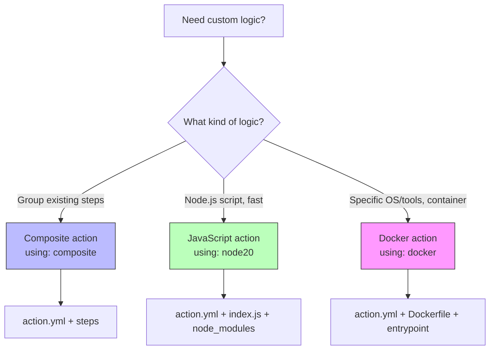

# Custom Actions

GitHub Actions has three action types: **Docker container**, **JavaScript**, and **Composite**. Custom actions let you package reusable logic that can be shared across workflows and repositories. The exam tests when to use each type and how to write `action.yml`.

> **Certification tip:** Composite actions are the most common for simple task grouping. Docker actions run in a container (great for language-specific tools). JavaScript actions run directly on the runner (fastest startup, Node.js required).

---

## 1. Action Types Comparison

| Type | Best for | Runs in | Startup speed | Example |
|------|----------|---------|---------------|---------|
| **Composite** | Combining multiple steps/actions | Runner shell | Fast | `steps:` with `run` and `uses` |
| **Docker container** | Language-specific tools, consistent env | Container | Slower (build/pull) | `Dockerfile` + `action.yml` |
| **JavaScript** | Fast, lightweight Node.js logic | Runner (Node) | Fastest | `index.js` + `action.yml` |

---

## 2. Composite Actions

A composite action groups multiple workflow steps into a single reusable unit.

### Structure

```
.my-action/
  action.yml
```

### `action.yml`

```yaml
name: 'My Composite Action'
description: 'Runs install and test in one step'
inputs:
  node-version:
    description: 'Node.js version'
    required: false
    default: '20.x'
outputs:
  result:
    description: 'The outcome'
runs:
  using: composite
  steps:
    - uses: actions/checkout@v4
    - uses: actions/setup-node@v4
      with:
        node-version: ${{ inputs.node-version }}
    - run: npm ci
    - id: test
      run: |
        npm test
        echo "result=passed" >> $GITHUB_OUTPUT
```

### Using a composite action

```yaml
jobs:
  test:
    runs-on: ubuntu-latest
    steps:
      - uses: ./.github/actions/my-composite-action
        with:
          node-version: '18.x'
```

### Local composite action path

```yaml
# Same repo
uses: ./.github/actions/my-action

# Another repo
uses: owner/repo/.github/actions/my-action@v1
```

> **Certification tip:** Composite actions use `using: composite` and cannot run on `windows-latest` with Docker-specific syntax. Outputs are set via `$GITHUB_OUTPUT` in a step with an `id`.

---

## 3. Docker Container Actions

A Docker action runs inside a container defined by a `Dockerfile`. Great when you need a specific OS, language runtime, or system dependencies.

### Structure

```
.docker-action/
  Dockerfile
  action.yml
  entrypoint.sh
```

### `Dockerfile`

```dockerfile
FROM alpine:3.18
RUN apk add --no-cache curl
COPY entrypoint.sh /entrypoint.sh
ENTRYPOINT ["/entrypoint.sh"]
```

### `entrypoint.sh`

```bash
#!/bin/sh
echo "Hello ${{ INPUT_NAME }}"
echo "result=done" >> $GITHUB_OUTPUT
```

### `action.yml`

```yaml
name: 'Docker Action'
description: 'Runs inside a Docker container'
inputs:
  name:
    description: 'Who to greet'
    required: true
outputs:
  result:
    description: 'Action result'
runs:
  using: docker
  image: Dockerfile
  inputs:
    name: ${{ inputs.name }}
```

### Using a Docker action

```yaml
jobs:
  greet:
    runs-on: ubuntu-latest
    steps:
      - uses: ./.github/actions/docker-action
        with:
          name: 'World'
```

> **Certification tip:** Docker actions use `using: docker` and reference `image: Dockerfile`. The `entrypoint.sh` must be executable (`chmod +x`). Docker actions are slower to start than composite or JavaScript actions.

---

## 4. JavaScript Actions

A JavaScript action runs Node.js code directly on the runner. Fastest startup, ideal for lightweight logic.

### Structure

```
.js-action/
  action.yml
  index.js
  node_modules/   # (or bundle with ncc)
  package.json
```

### `action.yml`

```yaml
name: 'JavaScript Action'
description: 'Fast Node.js action'
inputs:
  who-to-greet:
    description: 'Who to greet'
    required: true
    default: 'World'
outputs:
  time:
    description: 'The time we greeted you'
runs:
  using: node20
  main: index.js
```

### `index.js`

```javascript
const core = require('@actions/core');
const exec = require('@actions/exec');

async function run() {
  try {
    const whoToGreet = core.getInput('who-to-greet');
    const time = new Date().toISOString();
    core.setOutput('time', time);
    console.log(`Hello ${whoToGreet}!`);
  } catch (error) {
    core.setFailed(error.message);
  }
}

run();
```

### Using a JavaScript action

```yaml
jobs:
  greet:
    runs-on: ubuntu-latest
    steps:
      - uses: ./.github/actions/js-action
        with:
          who-to-greet: 'Learner'
```

### Bundling with ncc

JavaScript actions should bundle `node_modules` using `@vercel/ncc`:

```bash
ncc build index.js -o dist
```

Then update `action.yml`:
```yaml
runs:
  using: node20
  main: dist/index.js
```

> **Certification tip:** JavaScript actions use `using: node20` (or `node16`, `node18`, `node20`). The `main` entry point runs `index.js`. Use `@actions/core` for inputs/outputs and `core.setFailed()` for errors.

---

## 5. action.yml Reference

| Field | Required | Description |
|-------|----------|-------------|
| `name` | Yes | Action display name |
| `description` | Yes | What the action does |
| `inputs` | No | Input parameters |
| `outputs` | No | Output values |
| `runs` | Yes | How to run (using + main/image) |
| `branding` | No | Icon and color for marketplace |

### `inputs` schema

```yaml
inputs:
  input-id:
    description: 'Human readable'
    required: true    # or false
    default: 'value'  # optional
    # type: string | boolean | number (workflow_call only)
```

> **Certification tip:** In reusable workflows (`workflow_call`), inputs support `type: string | boolean | number`. In action.yml inputs, there's no `type` field — everything is a string.

### `branding` example

```yaml
branding:
  icon: 'check-circle'
  color: 'green'
```

---

## 6. Visual: Action Type Selection Flow



---

## 7. Real-World Use Case: Slack Notification Action

A composite action that sends a Slack notification with standardized formatting.

**`.github/actions/slack-notify/action.yml`:**

```yaml
name: 'Slack Notify'
description: 'Send a formatted Slack notification'
inputs:
  webhook:
    description: 'Slack webhook URL'
    required: true
  status:
    description: 'Job status'
    required: true
  job-name:
    description: 'Name of the job'
    required: true
runs:
  using: composite
  steps:
    - run: |
        PAYLOAD=$(cat <<EOF
        {
          "text": "*${{ inputs.job-name }}*",
          "attachments": [{
            "color": "${{ inputs.status == 'success' && 'good' || 'danger' }}",
            "text": "Status: ${{ inputs.status }}"
          }]
        }
        EOF
        )
        curl -X POST -H 'Content-type: application/json' \
          --data "$PAYLOAD" ${{ inputs.webhook }}
```

**Usage in a workflow:**

```yaml
jobs:
  deploy:
    runs-on: ubuntu-latest
    steps:
      - uses: ./.github/actions/slack-notify
        with:
          webhook: ${{ secrets.SLACK_WEBHOOK }}
          status: ${{ job.status }}
          job-name: Deploy
```

---

## 8. Hands-On Exercise: Composite Action

Create `.github/actions/say-hello/action.yml`:

```yaml
name: 'Say Hello'
description: 'A composite action that greets and records the time'
inputs:
  name:
    description: 'Person to greet'
    required: true
outputs:
  time:
    description: 'The time the greeting ran'
    value: ${{ steps.time.outputs.time }}
runs:
  using: composite
  steps:
    - run: echo "Hello ${{ inputs.name }}!"
    - id: time
      run: echo "time=$(date -u +%T)" >> $GITHUB_OUTPUT
```

Create `.github/workflows/action-test.yml`:

```yaml
name: Action Test

on:
  workflow_dispatch:

jobs:
  greet:
    runs-on: ubuntu-latest
    outputs:
      time: ${{ steps.hello.outputs.time }}
    steps:
      - id: hello
        uses: ./.github/actions/say-hello
        with:
          name: 'Learner'

  show-time:
    needs: greet
    runs-on: ubuntu-latest
    steps:
      - run: echo "The composite action completed at: ${{ needs.greet.outputs.time }}"
```

### Verification checklist
- [ ] The composite action runs and prints "Hello Learner!"
- [ ] The output `time` is accessible via `needs.greet.outputs.time` in the next job
- [ ] The action can be reused in other workflows in the same repo via `./.github/actions/say-hello`

> **Exam connection:** This covers composite actions (`using: composite`), action inputs, declaring action outputs in `action.yml`, and accessing outputs from the caller via `steps.<id>.outputs.<name>` or `needs.<job>.outputs.<name>`.

---

## 9. Quick Decision Guide

| You want to… | Action type |
|--------------|-------------|
| Group existing `run` and `uses` steps | Composite |
| Run a Node.js script quickly | JavaScript (`node20`) |
| Need a specific OS or system tools | Docker |
| Share across repos without publishing | Local path (`./.github/actions/`) |
| Publish to GitHub Marketplace | Public repo + `action.yml` |
| Set an output from an action | `$GITHUB_OUTPUT` (composite/Docker) or `core.setOutput()` (JS) |

---

**Next module:** [Self-Hosted Runners →](/study/self-hosted-runners/)
