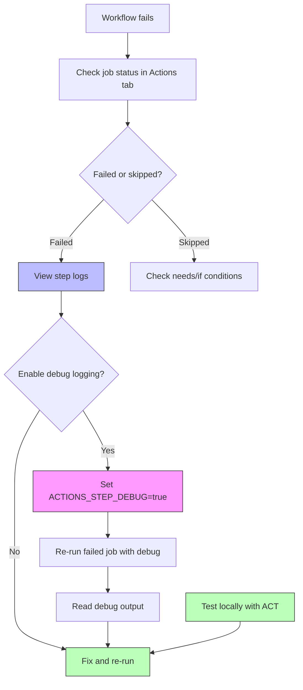

# Debugging & ACT

Even well-designed workflows fail sometimes. This module covers how to debug workflow runs, enable debug logging, use `step_summary`, re-run failed jobs, and test workflows locally with ACT.

> **Certification tip:** The exam tests how to interpret debug logs, when to use `continue-on-error` vs `if: always()`, and how ACT lets you test workflows locally without pushing.

---

## 1. Debug Logging

Enable verbose logging to see step execution details, masked values, and timing information.

### Enable debug logging

Repo Settings → Actions → General → Workflow debugging → Enable step debug logging

Or set a repository secret:
```
ACTIONS_STEP_DEBUG=true
```

### Debug log output

With debug logging enabled, you see:

```
##[debug]Evaluating: success()
##[debug]Evaluating: true
##[debug]Run npm test
##[debug]Successfully cached ~/.npm
```

### What debug logging reveals

- Expression evaluation results
- Cache hit/miss details
- Step timing
- Command execution details

> **Certification tip:** Never enable debug logging on workflows that handle secrets — secret values may appear in debug logs despite masking.

---

## 2. `step-summary` — Markdown Output from Steps

Steps can write to `$GITHUB_STEP_SUMMARY` to produce a Markdown summary that appears on the job's summary page.

### Example

```yaml
jobs:
  test:
    runs-on: ubuntu-latest
    steps:
      - run: npm test
      - name: Write test summary
        run: |
          echo "## Test Results" >> $GITHUB_STEP_SUMMARY
          echo "Total tests: 42" >> $GITHUB_STEP_SUMMARY
          echo "Passed: 40" >> $GITHUB_STEP_SUMMARY
          echo "Failed: 2" >> $GITHUB_STEP_SUMMARY
          echo "" >> $GITHUB_STEP_SUMMARY
          echo "See the logs for details." >> $GITHUB_STEP_SUMMARY
```

The summary appears on the workflow run page under the step.

---

## 3. Re-Running Failed Jobs

GitHub Actions lets you re-run specific jobs without re-running the entire workflow.

### Re-run options

| Option | Behavior |
|--------|----------|
| Re-run all jobs | Re-runs every job in the workflow |
| Re-run failed jobs | Re-runs only failed/cancelled jobs |
| Re-run specific jobs | Choose individual jobs |
| Re-run with debug logging | Enables `ACTIONS_STEP_DEBUG=true` for the re-run |

### `continue-on-error` vs `if: always()`

```yaml
jobs:
  test:
    runs-on: ubuntu-latest
    steps:
      - run: npm test
      - if: ${{ always() }}
        run: echo "Cleanup runs even if tests fail"
      - continue-on-error: true
        run: echo "This might fail but won't stop the job"
```

| Approach | Behavior |
|----------|----------|
| `continue-on-error: true` (step) | Step can fail, job continues to next step |
| `if: always()` (step) | Step runs regardless of previous step's result |
| `continue-on-error: true` (job) | Job can fail, workflow continues |
| `if: always()` (job) | Job runs even if needed jobs failed |

> **Certification tip:** Use `continue-on-error` to tolerate expected failures. Use `if: always()` to guarantee cleanup/notification steps run.

---

## 4. ACT — Local Workflow Testing

[ACT](https://github.com/nektos/act) lets you run GitHub Actions workflows locally on your machine using Docker. You can test without pushing to GitHub.

### Install ACT

**macOS:**
```bash
brew install act
```

**Linux:**
```bash
curl https://raw.githubusercontent.com/nektos/act/master/install.sh | sudo bash
```

### Run a workflow locally

```bash
# List workflows
act -l

# Run a specific workflow
act -W .github/workflows/ci.yml

# Run a specific job
act -j build

# Run with workflow_dispatch inputs
act workflow_dispatch -i name=Learner

# Run with secrets from a file
act --secret-file .secrets
```

### `.secrets` file format

```
GITHUB_TOKEN=your_token_here
NPM_TOKEN=npm_xxx
```

### ACT limitations

- Docker-in-Docker can be tricky on some systems
- Not all GitHub-hosted runner features are available locally
- Some actions may not work without a GitHub token
- Windows containers need Windows host

> **Certification tip:** ACT is excellent for rapid iteration but doesn't replace testing on real GitHub-hosted runners. Know that ACT uses Docker containers as runners locally.

---

## 5. Common Workflow Errors and Fixes

| Error | Cause | Fix |
|-------|-------|-----|
| `resource not accessible by integration` | `GITHUB_TOKEN` lacks permission | Add `permissions:` scope |
| `Cache not found` | First run or key changed | Normal — cache will be created |
| `Step failed: exit code 1` | Command returned non-zero | Check the command, add `continue-on-error` if expected |
| `Job skipped` | `needs` job failed or `if` false | Check dependency results and conditions |
| `Secret *** not found` | Secret name typo or wrong scope | Check secret name and environment scope |
| `ACT: Docker daemon not running` | Docker not started | Start Docker Desktop or daemon |

---

## 6. Visual: Debugging Flow



---

## 7. Real-World Use Case: Debugging a Failing Deployment

Scenario: A deploy job fails intermittently. You need to debug without waiting for the next push.

### Step 1: Enable debug logging

Add repository secret `ACTIONS_STEP_DEBUG=true`

### Step 2: Re-run with debug

Go to the failed workflow run → **Re-run jobs** → **Re-run failed jobs** → **Enable step debug logging**

### Step 3: Use ACT to reproduce locally

```bash
act -j deploy --secret-file .secrets
```

### Step 4: Add step summary for visibility

```yaml
jobs:
  deploy:
    runs-on: ubuntu-latest
    steps:
      - uses: actions/checkout@v4
      - run: ./deploy.sh
      - name: Write deployment summary
        if: always()
        run: |
          echo "## Deployment Result" >> $GITHUB_STEP_SUMMARY
          echo "Status: ${{ job.status }}" >> $GITHUB_STEP_SUMMARY
          echo "Environment: production" >> $GITHUB_STEP_SUMMARY
```

---

## 8. Hands-On Exercise: Debugging Practice

Create `.github/workflows/debugging.yml`:

```yaml
name: Debugging Exercise

on:
  workflow_dispatch:

jobs:
  step-that-fails:
    runs-on: ubuntu-latest
    steps:
      - run: echo "This step will succeed"
      - run: exit 1
        continue-on-error: true
      - run: echo "This step runs because continue-on-error was set"

  always-runs:
    needs: step-that-fails
    if: always()
    runs-on: ubuntu-latest
    steps:
      - run: echo "This runs even though the previous job failed"
      - run: echo "Previous result: ${{ needs.step-that-fails.result }}"

  summary-step:
    needs: always-runs
    runs-on: ubuntu-latest
    steps:
      - run: |
          echo "## Debug Summary" >> $GITHUB_STEP_SUMMARY
          echo "All jobs completed." >> $GITHUB_STEP_SUMMARY
```

### Verification checklist
- [ ] `step-that-fails` completes (because `continue-on-error: true`)
- [ ] `always-runs` executes (because `if: always()` on the job)
- [ ] `summary-step` produces a Markdown summary on the run page
- [ ] Enable `ACTIONS_STEP_DEBUG=true` repo secret and re-run to see debug logs

> **Exam connection:** This covers `continue-on-error`, `if: always()`, `$GITHUB_STEP_SUMMARY`, re-run failed jobs, and debug logging — all common troubleshooting exam topics.

---

## 9. Quick Decision Guide

| You want to… | Use this |
|--------------|----------|
| See detailed execution logs | `ACTIONS_STEP_DEBUG=true` secret |
| Show results on run page | `$GITHUB_STEP_SUMMARY` |
| Run cleanup regardless of failures | `if: always()` |
| Tolerate expected step failures | `continue-on-error: true` |
| Test workflows locally | ACT (`act` command) |
| Re-run only failed jobs | Actions tab → Re-run failed jobs |
| Debug why a job was skipped | Check `needs` results and `if` conditions |

---

**Next module:** [Practice Exams →](/study/practice-exams/)
