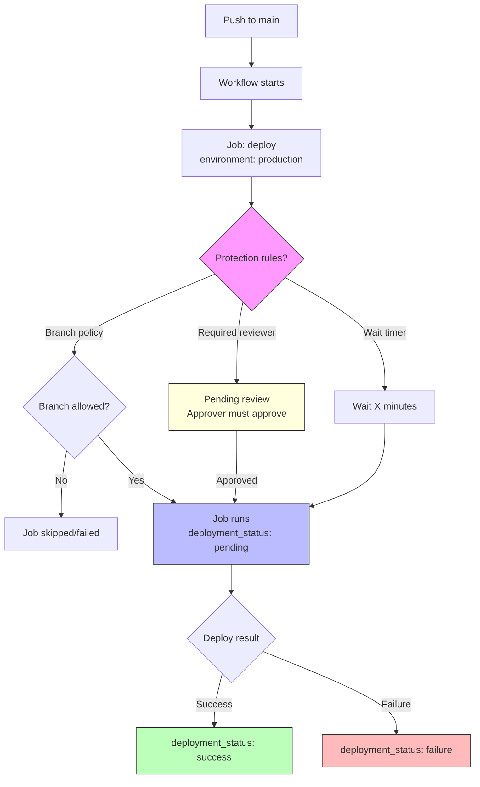

# Environments & Deployment

Environments let you gate deployments behind protection rules — required reviewers, wait timers, and branch restrictions. The exam tests how environments interact with secrets, deployment jobs, and the `deployment_status` event.

> **Certification tip:** Environment secrets are only accessible to jobs that reference that environment. Protection rules apply before the job starts running.

---

## 1. What Is an Environment?

An environment is a named deployment target (e.g. `staging`, `production`) configured in your repository settings at **Settings → Environments**.

Each environment can have:

- **Required reviewers** — specific people/teams who must approve
- **Wait timer** — delay before deployment starts (up to 6 hours)
- **Deployment branch policy** — restrict which branches can deploy
- **Custom deployment protection rules** (GitHub Enterprise / advanced)

### Environment secrets

Secrets scoped to an environment are only available to jobs that use `environment: <name>`. A job using `environment: production` cannot access `staging` secrets.

---

## 2. The `environment` Key in Jobs

Reference an environment in a job to trigger its protection rules.

```yaml
jobs:
  deploy-staging:
    environment: staging
    runs-on: ubuntu-latest
    steps:
      - uses: actions/checkout@v4
      - run: echo "Deploying to staging..."

  deploy-production:
    environment: production
    runs-on: ubuntu-latest
    steps:
      - uses: actions/checkout@v4
      - run: echo "Deploying to production..."
```

When the workflow run reaches `deploy-production`, GitHub:

1. Pauses the job
2. Applies protection rules (reviewers, wait timer, branch policy)
3. Waits for approval or timer expiry
4. Runs the job steps once cleared

### Environment URL (optional)

```yaml
jobs:
  deploy:
    environment:
      name: production
      url: https://myapp.example.com
    runs-on: ubuntu-latest
```

The URL appears in the deployments section of the repository.

---

## 3. Deployment Protection Rules

Configured per environment in repo settings.

### Required reviewers

One or more users/teams must approve the deployment before the job runs.

### Wait timer

A countdown (minutes) that must elapse before deployment proceeds. Reviewers can still approve during the wait.

### Deployment branch policy

Restrict deployments to specific branches:

| Option | Behavior |
|--------|----------|
| All branches | Any branch can deploy |
| Selected branches | Only listed branches (supports globs like `releases/*`) |
| Protected branches | Only branch-protected branches |

---

## 4. `deployment_status` Event

Triggered when a deployment's status changes. Use this for post-deployment notifications.

```yaml
on:
  deployment_status:
    types: [completed]

jobs:
  notify:
    if: github.event.deployment_status.state == 'success'
    runs-on: ubuntu-latest
    steps:
      - run: echo "Deployment ${{ github.event.deployment.id }} succeeded!"
```

| `state` value | Meaning |
|---------------|---------|
| `pending` | Deployment started |
| `success` | Deployment completed successfully |
| `failure` | Deployment failed |
| `inactive` | Deployment was deactivated (e.g. environment deleted) |

### Deployment status context

```yaml
if: ${{ github.event.deployment_status.state == 'failure' }}
```

Available fields:
- `github.event.deployment.id`
- `github.event.deployment.environment`
- `github.event.deployment.repository_url`
- `github.event.deployment_status.state`
- `github.event.deployment_status.description`

---

## 5. Deployment Jobs Pattern

A deployment job typically:

1. Checks out code
2. References an environment (triggers protection rules)
3. Deploys the artifact
4. Reports status

```yaml
name: Deploy

on:
  push:
    branches: [main]

jobs:
  deploy:
    environment:
      name: production
      url: https://app.example.com
    runs-on: ubuntu-latest
    permissions:
      contents: read
      deployments: write
    steps:
      - uses: actions/checkout@v4
      - uses: actions/download-artifact@v4
        with:
          name: build
      - run: |
          echo "Deploying to production..."
          # deploy commands here
      - run: echo "Deployment complete"
```

---

## 6. Visual: Deployment Flow with Protection



---

## 7. Real-World Use Case: Multi-Environment Deployment

Scenario: PRs deploy to a preview environment. Pushes to `main` deploy to staging with auto-approval. Pushes to `main` with a version tag deploy to production requiring manual approval.

```yaml
name: Multi-Environment Deploy

on:
  push:
    branches: [main]
    tags: [v*]
  pull_request:
    branches: [main]

jobs:
  # PR preview — no protection rules on preview env
  preview:
    if: github.event_name == 'pull_request'
    environment: preview
    runs-on: ubuntu-latest
    steps:
      - uses: actions/checkout@v4
      - run: echo "Deploying PR preview..."

  # Staging — main branch only, no approval needed
  staging:
    if: github.ref == 'refs/heads/main' && github.event_name == 'push'
    environment: staging
    runs-on: ubuntu-latest
    steps:
      - uses: actions/checkout@v4
      - run: echo "Deploying to staging..."

  # Production — tags only, requires manual approval
  production:
    if: startsWith(github.ref, 'refs/tags/v')
    environment:
      name: production
      url: https://app.example.com
    runs-on: ubuntu-latest
    permissions:
      contents: read
      deployments: write
    steps:
      - uses: actions/checkout@v4
      - run: echo "Deploying production release ${{ github.ref }}..."
```

### Environment setup required

| Environment | Protection Rules |
|-------------|-----------------|
| `preview` | None (auto-deploy) |
| `staging` | Wait timer: 0 minutes, branches: `main` |
| `production` | Required reviewers: `@org/release-team`, branches: `main` |

---

## 8. Hands-On Exercise: Environment with Approval

1. In your test repo, go to **Settings → Environments → New environment**
2. Name it `staging`
3. Add a **wait timer** of 1 minute
4. Add yourself as a **required reviewer**

Create `.github/workflows/deploy.yml`:

```yaml
name: Deploy Exercise

on:
  push:
    branches: [main]
  workflow_dispatch:

jobs:
  deploy:
    environment: staging
    runs-on: ubuntu-latest
    steps:
      - uses: actions/checkout@v4
      - run: |
          echo "Waiting for protection rules to clear..."
          echo "Deploying to staging environment!"
```

### Verification checklist
- [ ] Trigger the workflow — the `deploy` job should show "Waiting for protection rules"
- [ ] Approve the deployment from the Environments page or the run page
- [ ] Confirm the job runs after approval (after 1-minute wait timer)
- [ ] Check the Environments page shows the deployment history

> **Exam connection:** This covers `environment:`, protection rules, reviewers, wait timers, and deployment status — a high-frequency exam topic.

---

## 9. Quick Decision Guide

| You want to… | Use this |
|--------------|----------|
| Gate deployment behind human approval | Environment + required reviewers |
| Delay deployment automatically | Environment + wait timer |
| Restrict deploy branches | Environment + deployment branch policy |
| Scope secrets to a target | Environment secrets |
| Track deployment success/failure | `deployment_status` event |
| Show deployment URL in GitHub | `environment: { name, url }` |
| Write deployment status | `deployments: write` permission |

---

**Next module:** [Secrets & Variables →](/study/secrets-vars/)
