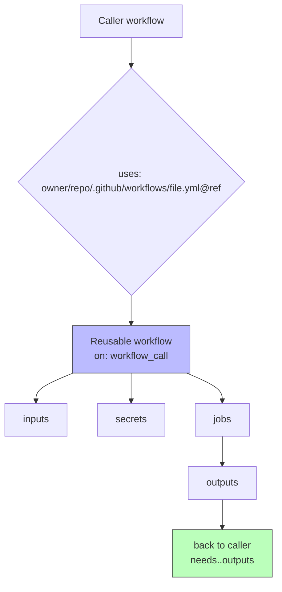

# Reusable Workflows

Reusable workflows let you extract common CI/CD logic into a single workflow file that other workflows can call. This reduces duplication, enforces standards, and is a high-frequency exam topic.

> **Certification tip:** A reusable workflow must start with `on: workflow_call`. It defines its own `inputs`, `outputs`, and `secrets`. The caller uses `uses: owner/repo/.github/workflows/file.yml@ref`.

---

## 1. The Reusable Workflow (Callee)

Create `.github/workflows/reusable-ci.yml` in the reusable repo:

```yaml
name: Reusable CI

on:
  workflow_call:
    inputs:
      node-version:
        description: 'Node.js version'
        required: false
        type: string
        default: '20.x'
      run-tests:
        description: 'Run test suite'
        required: false
        type: boolean
        default: true
    outputs:
      build-id:
        description: 'Unique build identifier'
        value: ${{ jobs.build.outputs.build-id }}
    secrets:
      DEPLOY_TOKEN:
        description: 'Deployment token'
        required: true

jobs:
  build:
    runs-on: ubuntu-latest
    outputs:
      build-id: ${{ steps.set-id.outputs.build-id }}
    steps:
      - uses: actions/checkout@v4
      - uses: actions/setup-node@v4
        with:
          node-version: ${{ inputs.node-version }}
      - id: set-id
        run: |
          echo "build-id=${{ github.run_id }}" >> $GITHUB_OUTPUT
      - if: ${{ inputs.run-tests }}
        run: |
          npm ci
          npm test
```

### Key elements of `workflow_call`

| Element | Purpose |
|---------|---------|
| `inputs` | Values passed from the caller (string, boolean, number) |
| `outputs` | Values returned to the caller |
| `secrets` | Secrets the reusable workflow needs (must be passed by caller) |

> **Certification tip:** `secrets` in `workflow_call` declare which secrets the reusable workflow expects. The caller must pass them explicitly using `secrets: inherit` or individual secret mapping.

---

## 2. Calling a Reusable Workflow (Caller)

In the consumer repo:

```yaml
name: Caller Pipeline

on:
  push:
    branches: [main]

jobs:
  ci:
    uses: octocat/ops/.github/workflows/reusable-ci.yml@main
    with:
      node-version: '18.x'
      run-tests: true
    secrets:
      DEPLOY_TOKEN: ${{ secrets.DEPLOY_TOKEN }}
```

### `uses` syntax

```yaml
uses: owner/repo/.github/workflows/file.yml@ref
# Example:
uses: myorg/ci-templates/.github/workflows/reusable-ci.yml@v1
uses: myorg/ci-templates/.github/workflows/reusable-ci.yml@main
```

### Passing inputs and secrets

```yaml
jobs:
  ci:
    uses: myorg/ci-templates/.github/workflows/reusable-ci.yml@main
    with:
      node-version: '20.x'
    secrets:
      DEPLOY_TOKEN: ${{ secrets.DEPLOY_TOKEN }}
      # OR pass all caller secrets:
      # secrets: inherit
```

| Secret passing | Behavior |
|----------------|----------|
| `secrets: inherit` | Passes all caller secrets to the reusable workflow |
| `secrets: DEPLOY_TOKEN: ${{ secrets.DEPLOY_TOKEN }}` | Pass specific secrets |

> **Certification tip:** `secrets: inherit` is convenient but over-privileged. For the exam, know that individual secret mapping is the principle of least privilege.

---

## 3. Accessing Reusable Workflow Outputs

```yaml
jobs:
  ci:
    uses: myorg/ci-templates/.github/workflows/reusable-ci.yml@main
    with:
      node-version: '20.x'
    secrets:
      DEPLOY_TOKEN: ${{ secrets.DEPLOY_TOKEN }}

  deploy:
    needs: ci
    runs-on: ubuntu-latest
    steps:
      - run: echo "Build ID: ${{ needs.ci.outputs.build-id }}"
```

The output comes from `jobs.build.outputs.build-id` in the reusable workflow, exposed via `on.workflow_call.outputs.build-id`.

---

## 4. Reusable Workflow with Composite Steps (Inline Composite)

Reusable workflows can also contain composite action steps:

```yaml
on:
  workflow_call:
    inputs:
      environment:
        required: true
        type: string

jobs:
  deploy:
    environment: ${{ inputs.environment }}
    runs-on: ubuntu-latest
    steps:
      - uses: actions/checkout@v4
      - run: echo "Deploying to ${{ inputs.environment }}"
```

---

## 5. Cross-Repository Reuse

Reusable workflows can be called from any repository that has access:

- **Same org:** Public or internal reusable workflows are accessible
- **Public repo:** Any public GitHub repo can call a public reusable workflow
- **Private repo:** Only repos in the same org (or with explicit access) can call

### Version pinning

Always pin to a SHA or tag, never `@main` in production:

```yaml
# ✅ Good — pinned
uses: myorg/ci/.github/workflows/reusable.yml@sha1234abc
uses: myorg/ci/.github/workflows/reusable.yml@v1.2.0

# ❌ Avoid — floating tag can change
uses: myorg/ci/.github/workflows/reusable.yml@main
```

---

## 6. Visual: Reusable Workflow Call Flow



---

## 7. Real-World Use Case: Standardized CI Template

Organization maintains a reusable CI template used by 20+ repositories.

**Reusable template** (`.github/workflows/standard-ci.yml` in `org/ci-templates`):

```yaml
name: Standard CI

on:
  workflow_call:
    inputs:
      language:
        required: true
        type: string
      version:
        required: false
        type: string
        default: 'latest'
    secrets:
      CODECOV_TOKEN:
        required: false

jobs:
  test:
    runs-on: ubuntu-latest
    steps:
      - uses: actions/checkout@v4
      - if: ${{ inputs.language == 'node' }}
        uses: actions/setup-node@v4
        with:
          node-version: ${{ inputs.version }}
      - if: ${{ inputs.language == 'python' }}
        uses: actions/setup-python@v5
        with:
          python-version: ${{ inputs.version }}
      - run: echo "Running tests for ${{ inputs.language }}"
      - if: ${{ secrets.CODECOV_TOKEN }}
        run: echo "Uploading coverage..."
```

**Caller** (in any org repo):

```yaml
name: CI

on: push

jobs:
  ci:
    uses: org/ci-templates/.github/workflows/standard-ci.yml@v1
    with:
      language: node
      version: '20.x'
    secrets:
      CODECOV_TOKEN: ${{ secrets.CODECOV_TOKEN }}
```

---

## 8. Hands-On Exercise: Reusable Workflow

You need two repositories for this exercise, or simulate with one.

**Reusable workflow** (`.github/workflows/reusable-greeting.yml`):

```yaml
name: Reusable Greeting

on:
  workflow_call:
    inputs:
      name:
        required: true
        type: string
    outputs:
      greeting:
        description: 'The generated greeting'
        value: ${{ jobs.greet.outputs.greeting }}
    secrets:
      PREFIX:
        required: false

jobs:
  greet:
    runs-on: ubuntu-latest
    outputs:
      greeting: ${{ steps.gen.outputs.greeting }}
    steps:
      - id: gen
        run: |
          GREETING="${{ secrets.PREFIX || 'Hello' }}, ${{ inputs.name }}!"
          echo "greeting=$GREETING" >> $GITHUB_OUTPUT
```

**Caller workflow** (`.github/workflows/caller.yml`):

```yaml
name: Caller

on:
  workflow_dispatch:
    inputs:
      name:
        required: true
        type: string

jobs:
  greet:
    uses: ./.github/workflows/reusable-greeting.yml
    with:
      name: ${{ github.event.inputs.name }}
    secrets:
      PREFIX: ${{ secrets.PREFIX }}

  show-result:
    needs: greet
    runs-on: ubuntu-latest
    steps:
      - run: echo "Result: ${{ needs.greet.outputs.greeting }}"
```

### Verification checklist
- [ ] Trigger the caller workflow with a name input
- [ ] Confirm the greeting appears in the final job output
- [ ] Add a `PREFIX` secret and confirm it's prepended to the greeting

> **Exam connection:** This covers `workflow_call`, `inputs`, `outputs`, `secrets`, local reuse (`./.github/workflows/`), and `needs.<job>.outputs` — all exam essentials.

---

## 9. Quick Decision Guide

| You want to… | Use this |
|--------------|----------|
| Share CI logic across repos | Reusable workflow (`workflow_call`) |
| Pass data into a reusable workflow | `inputs` |
| Get data back from a reusable workflow | `outputs` |
| Grant a reusable workflow access to secrets | `secrets` in `workflow_call` + `secrets:` in caller |
| Pass all caller secrets | `secrets: inherit` |
| Pin to a specific version | `@sha` or `@tag` (never `@main`) |
| Reuse within same repo | `uses: ./.github/workflows/file.yml` |

---

**Next module:** [Custom Actions →](/study/custom-actions/)
