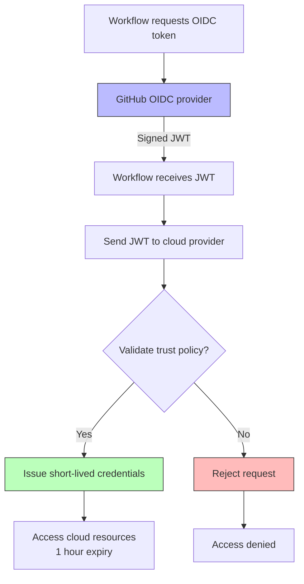

# Security & OIDC

Security is one of the heaviest exam domains. You need to know how to scope `GITHUB_TOKEN`, configure `permissions`, use OIDC to avoid long-lived secrets, and understand artifact attestation and supply-chain protections.

> **Certification tip:** Never store long-lived cloud credentials (AWS keys, Azure client secrets) in GitHub secrets. Use OIDC to get short-lived tokens instead.

---

## 1. `permissions` — Principle of Least Privilege

The `permissions` key scopes what the `GITHUB_TOKEN` can do. Set it at the workflow or job level.

### Workflow-level permissions

```yaml
permissions:
  contents: read
  pull-requests: write
  issues: write
```

### Job-level permissions (overrides workflow)

```yaml
jobs:
  deploy:
    permissions:
      contents: write      # Needed to create releases/tags
      id-token: write      # Needed for OIDC
    runs-on: ubuntu-latest
    steps:
      - run: echo "Deploying with scoped permissions"
```

### All permission scopes

| Scope | Values | Purpose |
|-------|--------|---------|
| `actions` | read, write | Manage workflows, artifacts, cache |
| `checks` | read, write | Create check runs and suites |
| `contents` | read, write | Read/write repository contents |
| `deployments` | read, write | Create deployment statuses |
| `id-token` | write | Request OIDC tokens |
| `issues` | read, write | Manage issues |
| `packages` | read, write | Publish packages |
| `pull-requests` | read, write | Manage PRs |
| `repository-projects` | read, write | Manage projects |
| `security-events` | read, write | Code scanning alerts |
| `statuses` | read, write | Commit statuses |

> **Certification tip:** If you don't set `permissions`, GitHub uses defaults that are often too broad. Always set `permissions: contents: read` at minimum for read-only workflows.

---

## 2. OIDC (OpenID Connect) — Federated Identity

OIDC lets your workflow request a short-lived token from your cloud provider (AWS, Azure, GCP) without storing long-lived credentials in GitHub secrets.

### How OIDC works

```text
1. GitHub Actions requests an OIDC token from GitHub's OIDC provider
2. GitHub signs a JWT containing repository, workflow, and job metadata
3. Workflow sends the JWT to the cloud provider
4. Cloud provider validates the JWT against a trust policy
5. Cloud provider issues short-lived credentials
6. Credentials expire automatically (typically 1 hour)
```

### AWS OIDC example

**Trust policy (in AWS IAM):**

```json
{
  "Version": "2012-10-17",
  "Statement": [
    {
      "Effect": "Allow",
      "Principal": {
        "Federated": "arn:aws:iam::ACCOUNT_ID:oidc-provider/token.actions.githubusercontent.com"
      },
      "Action": "sts:AssumeRoleWithWebIdentity",
      "Condition": {
        "StringLike": {
          "token.actions.githubusercontent.com:sub": "repo:OWNER/REPO:*"
        }
      }
    }
  ]
}
```

**Workflow:**

```yaml
jobs:
  deploy-aws:
    runs-on: ubuntu-latest
    permissions:
      id-token: write      # Required for OIDC
      contents: read
    steps:
      - uses: actions/checkout@v4
      - uses: aws-actions/configure-aws-credentials@v4
        with:
          role-to-assume: arn:aws:iam::ACCOUNT_ID:role/GitHubActionsRole
          aws-region: us-east-1
      - run: aws s3 ls
```

### Azure OIDC example

```yaml
jobs:
  deploy-azure:
    runs-on: ubuntu-latest
    permissions:
      id-token: write
    steps:
      - uses: azure/login@v2
        with:
          client-id: ${{ secrets.AZURE_CLIENT_ID }}
          tenant-id: ${{ secrets.AZURE_TENANT_ID }}
          subscription-id: ${{ secrets.AZURE_SUBSCRIPTION_ID }}
```

### GCP OIDC example

```yaml
jobs:
  deploy-gcp:
    runs-on: ubuntu-latest
    permissions:
      id-token: write
      contents: read
    steps:
      - id: 'auth'
        name: 'Authenticate to Google Cloud'
        uses: 'google-github-actions/auth@v2'
        with:
          workload_identity_provider: 'projects/123456/locations/global/workloadIdentityPools/my-pool/providers/my-provider'
          service_account: 'my-sa@my-project.iam.gserviceaccount.com'
      - run: gcloud auth list
```

> **Certification tip:** OIDC requires `id-token: write` permission. Without it, the workflow cannot request an OIDC token. No AWS secret keys, no Azure client secrets — ever.

---

## 3. Artifact Attestation

Artifact attestation (via `actions/attest-build-provenance`) creates a cryptographically signed statement about how a build artifact was produced. This is part of SLSA (Supply-chain Levels for Software Artifacts).

### Basic attestation

```yaml
jobs:
  build:
    runs-on: ubuntu-latest
    permissions:
      contents: read
      actions: write
      id-token: write
    steps:
      - uses: actions/checkout@v4
      - run: |
          echo "build content" > artifact.txt
      - name: Attest build provenance
        uses: actions/attest-build-provenance@v1
        with:
          subject-path: 'artifact.txt'
          policy-path: './attestation.policy'
```

### Attestation policy example (`attestation.policy`)

```json
{
  "predicateType": "https://slsa.dev/provenance/v0.2",
  "definition": {
    "buildType": "https://github.com/actions/attest-build-provenance",
    "buildSteps": [
      {
        "name": "checkout",
        "action": "actions/checkout@v4"
      }
    ]
  }
}
```

### Why attestation matters

- Proves who built the artifact and from what source
- Enables policy enforcement downstream (e.g., only deploy attested artifacts)
- Part of supply-chain security (SLSA levels 1-3)

> **Certification tip:** Attestation requires `actions: write` and `id-token: write` permissions. The subject-path is the artifact being attested.

---

## 4. Secret Scanning & Push Protection

GitHub can scan repositories for accidentally committed secrets.

### Secret scanning

- Automatically scans repo history and new commits
- Detects AWS keys, GitHub tokens, Slack tokens, etc.
- Sends alerts to repo admins and secret owners

### Push protection

- Blocks pushes that contain secrets
- Prevents secrets from ever entering the repo
- Can be bypassed with justification (logged)

### Configuring push protection

Repo Settings → Security → Code security and analysis → Secret scanning → Push protection

---

## 5. Signed Commits & Commit Verification

Require signed commits to ensure authorship integrity.

```yaml
jobs:
  verify-commits:
    runs-on: ubuntu-latest
    steps:
      - uses: actions/checkout@v4
        with:
          fetch-depth: 0
      - run: git log --format='%H %G?' | head -20
```

- `G` = good signature
- `B` = bad signature
- `U` = unknown signature
- `N` = not signed

---

## 6. Visual: OIDC Flow



---

## 7. Real-World Use Case: Secure AWS Deployment Without Secrets

Scenario: Deploy an application to AWS S3 using OIDC — no AWS access keys stored anywhere.

### Prerequisites

1. Create an OIDC identity provider in AWS IAM pointing to `token.actions.githubusercontent.com`
2. Create an IAM role with a trust policy allowing your repo
3. Add S3 permissions to the role

### Workflow

```yaml
name: Secure AWS Deploy

on:
  push:
    branches: [main]

jobs:
  deploy:
    runs-on: ubuntu-latest
    permissions:
      id-token: write      # Required for OIDC
      contents: read       # Required for checkout
    steps:
      - uses: actions/checkout@v4

      - name: Configure AWS credentials via OIDC
        uses: aws-actions/configure-aws-credentials@v4
        with:
          role-to-assume: arn:aws:iam::123456789012:role/GitHubActionsDeployRole
          aws-region: us-east-1

      - name: Deploy to S3
        run: |
          aws s3 sync ./dist s3://my-app-bucket/ --delete

      - name: Verify deployment
        run: aws s3 ls s3://my-app-bucket/
```

### What's NOT in this workflow

❌ No `AWS_ACCESS_KEY_ID` secret  
❌ No `AWS_SECRET_ACCESS_KEY` secret  
❌ No long-lived credentials of any kind

---

## 8. Hands-On Exercise: Permissions + OIDC Simulation

You don't need a cloud account for this exercise. Practice the `permissions` syntax.

Create `.github/workflows/security.yml`:

```yaml
name: Security Exercise

on:
  workflow_dispatch:

permissions:
  contents: read       # Workflow-level default

jobs:
  # This job can only read contents
  read-only:
    runs-on: ubuntu-latest
    steps:
      - uses: actions/checkout@v4
      - run: echo "I can read the repo"

  # This job overrides with broader permissions
  create-release:
    needs: read-only
    permissions:
      contents: write   # Override for this job only
    runs-on: ubuntu-latest
    steps:
      - run: echo "I could create a release (but won't in this exercise)"

  # OIDC simulation — requests id-token permission
  oidc-demo:
    permissions:
      id-token: write   # Required to request OIDC token
    runs-on: ubuntu-latest
    steps:
      - run: echo "I can request an OIDC token from GitHub"
```

### Verification checklist
- [ ] Workflow-level `contents: read` applies to all jobs unless overridden
- [ ] `create-release` job has `contents: write` (job-level override)
- [ ] `oidc-demo` job has `id-token: write` (required for OIDC)
- [ ] No AWS/Azure/GCP secrets stored in the repo

> **Exam connection:** This covers `permissions` scoping, job-level overrides, `id-token: write` for OIDC, and the principle of least privilege — all high-frequency security questions.

---

## 9. Quick Decision Guide

| You want to… | Use this |
|--------------|----------|
| Limit `GITHUB_TOKEN` scope | `permissions:` at workflow or job level |
| Deploy to AWS without secrets | OIDC + `id-token: write` |
| Deploy to Azure without secrets | OIDC + `azure/login@v2` |
| Deploy to GCP without secrets | OIDC + `google-github-actions/auth@v2` |
| Prove build provenance | `actions/attest-build-provenance@v1` |
| Prevent committed secrets | Secret scanning + push protection |
| Verify commit authorship | Signed commits + `git log --format='%G?'` |
| Minimum permission for read-only CI | `contents: read` |

---

**Next module:** [Caching & Artifacts →](/study/caching-artifacts/)
