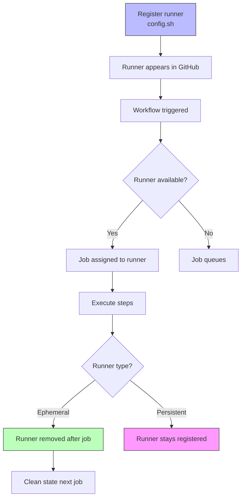

# Self-Hosted Runners

GitHub-hosted runners are convenient, but sometimes you need your own infrastructure — for specialized tools, internal network access, long-running jobs, or cost control. Self-hosted runners give you full control over the machine running your jobs.

> **Certification tip:** Self-hosted runners are **not** automatically updated or patched by GitHub. You manage security, capacity, and maintenance. They also don't have the same spending limits as GitHub-hosted runners.

---

## 1. What Is a Self-Hosted Runner?

A self-hosted runner is a machine you own and manage that executes GitHub Actions jobs. You register it to a repository, organization, or enterprise, then reference it with `runs-on: self-hosted` or a custom label.

### Registration levels

| Level | Scope | Where to register |
|-------|-------|-------------------|
| Repository | One repo only | Repo Settings → Actions → Runners |
| Organization | Selected repos in org | Org Settings → Actions → Runner groups |
| Enterprise | All orgs in enterprise | Enterprise Settings → Actions → Runners |

---

## 2. Adding a Self-Hosted Runner

### Step 1: Add the runner

In your repo, go to **Settings → Actions → Runners → New self-hosted runner**. Choose your OS (Linux, Windows, macOS).

### Step 2: Download and configure

GitHub provides a download command and configuration script:

```bash
mkdir actions-runner && cd actions-runner
curl -o actions-runner-linux-x64-2.311.0.tar.gz -L https://github.com/actions/runner/releases/download/v2.311.0/actions-runner-linux-x64-2.311.0.tar.gz
tar xzf ./actions-runner-linux-x64-2.311.0.tar.gz
./config.sh --url https://github.com/OWNER/REPO --token TOKEN
```

The token is one-time use and expires after registration.

### Step 3: Run the runner

```bash
./run.sh
```

The runner now appears in the Actions tab and can pick up jobs.

### Step 4: Run as a service (production)

```bash
sudo ./svc.sh install
sudo ./svc.sh start
```

---

## 3. `runs-on` for Self-Hosted Runners

```yaml
jobs:
  build:
    runs-on: self-hosted
    steps:
      - run: echo "Running on my own machine"
```

### With custom labels

Labels let you target specific runner capabilities:

```yaml
jobs:
  build-linux:
    runs-on: [self-hosted, linux, x64]
    steps:
      - run: echo "Linux x64 runner"

  build-arm:
    runs-on: [self-hosted, linux, arm64]
    steps:
      - run: echo "ARM64 runner"

  build-windows:
    runs-on: [self-hosted, windows]
    steps:
      - run: echo "Windows runner"
```

Labels are configured during runner registration or in the runner settings UI.

---

## 4. Ephemeral vs Persistent Runners

### Ephemeral runners

Ephemeral runners are removed after a single job completes. This is the recommended, secure option.

```bash
./config.sh --ephemeral
```

| Aspect | Ephemeral |
|--------|-----------|
| Lifespan | One job |
| State | Clean slate each job |
| Security | High — no leftover state |
| Best for | Most CI/CD workloads |

### Persistent runners

Persistent runners stay registered and reuse disk state between jobs.

| Aspect | Persistent |
|--------|------------|
| Lifespan | Until manually removed |
| State | Persists between jobs |
| Security | Lower — potential state leakage |
| Best for | Long-running builds, cached dependencies |

> **Certification tip:** Always prefer ephemeral runners for security. Persistent runners can leak credentials, cache, or build artifacts between jobs.

---

## 5. Runner Groups

Runner groups let you organize runners and control which repositories can use them.

### Organization-level runner groups

- **Default group:** All runners, accessible to all repos
- **Custom group:** Restricted to selected repositories

```yaml
# Targeting a runner group (GitHub Enterprise / organization)
runs-on:
  group: production-runners
  labels: [linux, x64]
```

```yaml
# Or with self-hosted + group
runs-on: [self-hosted, production-runners]
```

---

## 6. Runner Application Version

Keep the runner application updated. Outdated runners may not support new features or security fixes.

Check version:
```bash
./run.sh --version
```

Update by downloading the latest runner package and re-running `config.sh`.

---

## 7. Security Considerations

Self-hosted runners run code from your repository (and potentially from PRs). Key risks:

| Risk | Mitigation |
|------|------------|
| Untrusted code from fork PRs | Don't run self-hosted runners on fork PRs |
| Persistent state leakage | Use `--ephemeral` |
| Network access to internal systems | Isolate runners, limit firewall rules |
| Runner compromise | Rotate runner tokens, monitor logs |
| No automatic patching | Manually patch the OS and runner |

> **Certification tip:** Never use self-hosted runners for pull requests from public forks. The code runs with access to your runner's environment and network.

---

## 8. Visual: Runner Lifecycle



---

## 9. Real-World Use Case: Internal Docker Registry

Scenario: Your company has an internal Docker registry that GitHub-hosted runners can't reach. You need a self-hosted runner in your VPC.

### Runner setup

```bash
# On an EC2 instance in your VPC
./config.sh --url https://github.com/myorg/myrepo --token TOKEN --ephemeral --labels docker-registry-access
```

### Workflow

```yaml
name: Build and Push to Internal Registry

on:
  push:
    branches: [main]

jobs:
  build:
    runs-on: [self-hosted, docker-registry-access]
    steps:
      - uses: actions/checkout@v4
      - run: |
          docker build -t internal-registry.mycompany.com/app:${{ github.sha }} .
          docker push internal-registry.mycompany.com/app:${{ github.sha }}
```

The runner has network access to `internal-registry.mycompany.com`, which GitHub-hosted runners cannot reach.

---

## 10. Hands-On Exercise: Self-Hosted Runner

### Part 1: Register a runner

1. Go to your repo → **Settings → Actions → Runners → New self-hosted runner**
2. Choose Linux, download the runner package
3. Run `./config.sh` with the provided URL and token
4. Run `./run.sh`
5. Confirm the runner appears as "Idle" in the runner list

### Part 2: Target the runner

Create `.github/workflows/self-hosted.yml`:

```yaml
name: Self-Hosted Test

on:
  workflow_dispatch:

jobs:
  info:
    runs-on: self-hosted
    steps:
      - run: |
          echo "Runner OS: ${{ runner.os }}"
          echo "Runner name: ${{ runner.name }}"
          echo "Working directory: ${{ runner.temp }}"
          uname -a
```

### Verification checklist
- [ ] Runner appears in the repo's runner list as "Idle"
- [ ] Workflow runs on the self-hosted runner (not GitHub-hosted)
- [ ] Output shows the runner's actual OS and details
- [ ] Runner becomes idle again after the job completes

> **Exam connection:** This covers `runs-on: self-hosted`, labels, ephemeral vs persistent, runner groups, and the security risk of fork PRs — all common exam topics.

---

## 11. Quick Decision Guide

| You want to… | Use this |
|--------------|----------|
| Run on your own infrastructure | `runs-on: self-hosted` |
| Target specific hardware/OS | Labels (e.g. `self-hosted, linux, arm64`) |
| Clean state every job | `--ephemeral` runner |
| Reuse cached state between jobs | Persistent runner |
| Restrict runner to specific repos | Runner groups |
| Access internal network/registry | Self-hosted runner in your VPC |
| Run fork PR code safely | **GitHub-hosted runners only** — never self-hosted for forks |

---

**Next module:** [Security & OIDC →](/study/security-oidc/)
